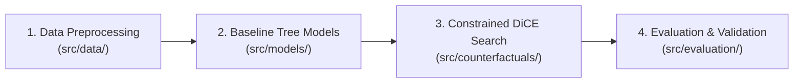

# Safe-by-Design Nanotoxicology with Constrained Counterfactuals (DiCE)

An applied machine learning research repository implementing a **Safe-by-Design (SbD)** framework for nanomaterials using **Diverse Counterfactual Explanations (DiCE)** under realistic physicochemical and domain constraints.

---

## Project Overview

Nanotechnology offers significant advancements across medicine, material science, and electronics; however, nanomaterials can induce toxicological liabilities such as membrane damage, reactive oxygen species (ROS) generation, and decreased cell viability. The Safe-by-Design (SbD) approach aims to identify minimal, actionable modifications to nanoparticle properties (e.g., surface coating, core size, zeta potential) to transform predicted toxic candidates into safe alternatives while preserving intended function.

This repository implements constrained counterfactual search algorithms (via DiCE) to provide interpretable, actionable guidance for synthetic chemists and toxicologists.

---

## Research Workflow

The pipeline consists of four sequential stages:



1. **Data Preprocessing (`src/data/`)**:
   - Ingest and standardize physicochemical descriptors (core composition, hydrodynamic diameter, zeta potential, surface functionalization/coating, aspect ratio).
   - Clean, curate, and harmonize toxicological endpoints (viability %, cytotoxicity, ROS generation).
   - Implement data validation, missing value imputation, normalization, and stratified dataset splits.

2. **Baseline Tree Models (`src/models/`)**:
   - Train and cross-validate baseline tree ensembles (Random Forest, XGBoost, LightGBM) on tabular nanomaterial property-activity relationships.
   - Perform hyperparameter tuning and model calibration.
   - Establish baseline performance metrics (ROC-AUC, F1, Balanced Accuracy, RMSE) and tree-based feature importance.

3. **Constrained DiCE Counterfactual Search (`src/counterfactuals/`)**:
   - Formulate Safe-by-Design redesign objectives via Diverse Counterfactual Explanations (DiCE).
   - Apply domain-specific physicochemical constraints:
     - **Immutable features**: Core material composition and inherent matrix properties.
     - **Mutable design levers**: Surface coating, shell thickness, functional groups, capping ligands, and size dimensions.
     - **Synthesizability bounds**: Realistic physical parameter ranges and directional constraints.
   - Search for minimal perturbations that flip the model's toxicity prediction from toxic to non-toxic.

4. **Evaluation & Validation (`src/evaluation/`)**:
   - **Proximity**: Quantify distance from the original nanoparticle ($L_1$, $L_2$, normalized Manhattan).
   - **Sparsity**: Measure the number of design levers modified.
   - **Diversity**: Evaluate coverage and variance across generated alternative counterfactuals.
   - **Domain Plausibility**: Check consistency against known nanoparticle synthesis constraints and empirical data distributions.

---

## Repository Structure

```text
nanotox-dice/
├── configs/               # Experiment and model configuration files (YAML/JSON)
├── data/
│   ├── raw/               # Raw experimental assay datasets (git-ignored)
│   └── processed/         # Cleaned, standardized datasets for modeling
├── docs/                  # Project documentation, protocol notes, and literature refs
├── notebooks/             # Exploratory analysis, visualization, and prototyping notebooks
├── results/
│   ├── figures/           # Generated plots, diagrams, and counterfactual visualizations
│   └── tables/            # Model performance benchmarks and counterfactual metrics
├── src/
│   ├── __init__.py
│   ├── data/              # Data ingestion, transformation, and feature engineering
│   ├── models/            # Baseline tree ensemble training, tuning, and inference
│   ├── counterfactuals/   # Constrained DiCE counterfactual search implementations
│   └── evaluation/        # Metrics for proximity, sparsity, diversity, and feasibility
├── tests/                 # Unit and integration test suite
├── .gitignore             # Git exclusion rules (venv, __pycache__, notebooks, raw data)
└── README.md              # Project overview and research workflow
```

---

## Getting Started

### Prerequisites
- Python >= 3.10
- Recommended environment: `venv` or `uv`

### Setup
```bash
# Clone the repository
git clone <repo-url>
cd nanotox-dice

# Create and activate a virtual environment
python -m venv .venv
source .venv/bin/activate

# Install dependencies (once requirements/pyproject is configured)
pip install --upgrade pip
```
